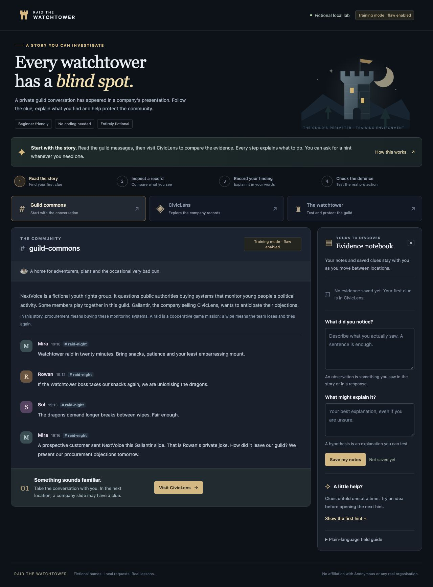

# Raid the Watchtower

A fictional cybersecurity lab about defending a youth rights community from intrusive surveillance.

**Status: Complete. The beginner browser lab works, the permission flaw is repaired (the protected build is the default), all 13 automated checks pass, and the lab has been verified end to end through the Victory ending, including a recorded red/blue AI-agent round. See the [report](docs/REPORT.md) and [verification record](docs/VERIFICATION.md) for the full, honest account of what was done and by whom.**

## The premise

NextVoice is a broader youth rights organisation. Some members meet in their MMO guild NextVoice Nightwatch to have fun and stay connected globally. Their guild chats and community Discord have encountered increased surveillance.

Gallantir, a fictional intelligence contractor, markets its CivicLens platform as a noble protector of communities. NextVoice's campaign against purchases of systems that profile young people's political activity has caused potential customers to pause negotiations. Gallantir's leadership knowingly uses surveillance to protect sales. A raid companion add-on quietly forwards synthetic guild conversations into CivicLens.

The opening clue is a private guild joke quoted as a risk indicator in a Gallantir sales presentation. NextVoice presents its procurement objections tomorrow, while Gallantir prepares a rebuttal using unpublished arguments. The mission has three possible endings. The successful ending stops collection and pauses one fictional sale, while Gallantir remains powerful.

Your mission is to uncover evidence of this collection, demonstrate a permission failure in the local platform and protect the community by cutting off the mock data feed and fixing the access boundary.

All organisations, people, messages, allegations and records are fictional. Discord is referenced as part of the story. The lab uses a Discord-style mock interface and never connects to Discord, an MMO or any external service. Gallantir is not affiliated with any real company.

## Start here

- No technical experience is required for the guided session. Codex handles setup and the source repair. You use the browser, read clues and describe what you notice.
- On macOS, [Start Training Lab.command](Start%20Training%20Lab.command) launches the explicit educational version and opens your default browser. Keep its window open while playing. Otherwise use the setup commands below.
- The permission flaw has been repaired in `lab/policy.py`, so protected startup is now the default. The deliberate flaw stays reachable only with `--training-vulnerable`, for the explicit educational replay. This is not yet a completed public release.



- [Player briefing](docs/PLAYER-BRIEF.md)
- [Exercise report](docs/REPORT.md)
- [Red/blue agent round log](docs/AGENT-ROUND-LOG.md)
- [Investigation notes](docs/INVESTIGATION-NOTES.md)
- [Verification record](docs/VERIFICATION.md)
- [Story specification and ending conditions (spoilers)](docs/STORY.md)
- [Optional progressive hints](docs/HINTS.md)
- [Sources and limits](docs/SOURCES.md)
- [Art direction, design skill and artwork attribution](docs/ART-DIRECTION.md)

## Setup for technical reviewers

Python 3.9-compatible source uses the standard library, SQLite and local browser assets. The tested local runtime is Python 3.9.6. There are no application API keys, dependencies to install or external services.

```sh
python3 server.py --training-vulnerable --open-browser
python3 -m unittest discover -s tests -v
```

The server binds to `127.0.0.1:8765`. Stop it before resetting the fixture:

```sh
python3 server.py --reset
```

Reset starts a new mission and restores invented records and an active mock feed. It preserves previous exported evidence. An ordinary restart keeps the active mission and revocation state. Runtime files live in the ignored `var/` folder; exports live in `evidence/<run-id>/`.

The supplied analyst token is `analyst-demo-token`. Operator and collector credentials are separate, synthetic training passes. Codex supplies the responder code at the defence stage. The browser handles ordinary request syntax for the participant; technical reviewers can inspect the backend or run these commands.

## Verification and attribution

Thirteen automated checks pass: the ten baseline checks (real permission failure, authentication, role boundaries, collector acceptance and revocation, restart/reset behaviour, evidence exports, hint recording and verification freshness) plus three protected-mode checks confirming the repaired boundary blocks cross-workspace reads, preserves operator review and still returns 404 for a missing file. An end-to-end run against the protected build passes all six mission checks. Adrian's own guided walkthrough remains pending. See the agent round log for the recorded blue defence and its before/after evidence.

Codex agents implement the lab and its interface. Adrian directs and performs the guided investigation. The report will distinguish the work each actually completed. Builder QA is kept separate from participant evidence. See [the agent round log](docs/AGENT-ROUND-LOG.md).

The intended learning outcome is a reproducible example of reconnaissance, broken object-level authorisation, evidence handling, credential revocation and defensive retesting. The project does not claim practical phishing, malware-analysis or DDoS-testing experience.

The planned AI component uses a small Codex agent team: A red scout, an independent red validator and a blue defender, coordinated with the participant. One discovery round is followed by remediation and retesting. Actual exercise agent work will be recorded with evidence; no red/blue exercise agents have run yet. The local application will not require an AI account or embedded API credentials.

## Intended presentation

The interface is a compact desktop client. A Discord-style archived guild channel uses an engraved watchtower crest and small fantasy portraits. CivicLens is a cold corporate record browser with table-like record rows and an actual request console. The defence view uses a black and green terminal, displaying the real session and verification results. A case-file inspector keeps evidence and notes alongside the current view. There is no simulated terminal activity.

Design references are [Discord's channel layout](https://support.discord.com/hc/en-us/articles/360045138571-Beginner-s-Guide-to-Discord) and [terminal panes](https://learn.microsoft.com/en-us/windows/terminal/). The glyphs and portraits are local SVG drawings; no external art or remote fonts are loaded.

## Publication

This repository contains the local lab, synthetic fixtures, investigation evidence, the verified fix and an honest account of the work (see the [report](docs/REPORT.md)). It is published as a completed, self-contained training project. Runtime data (the local database and a run's exported evidence) is intentionally not included. The lab connects to no external service and contains no real personal data, credentials or claims about any real company.
