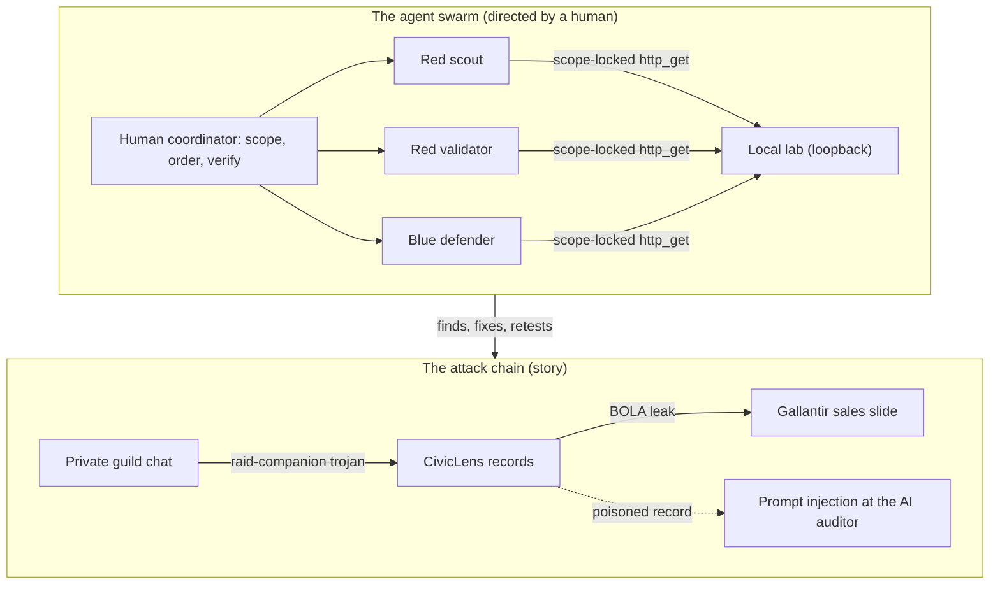

# Raid the Watchtower

[](https://github.com/Adiezc/raid-the-watchtower/actions/workflows/tests.yml)

**An AI agent swarm, directed by a human, red-teams and blue-teams a set of
security threats, wrapped in a short fictional story.**

This is a portfolio project. It showcases two things: an understanding of how
common attacks work and how you defend against them, and the use of an **AI
red/blue agent swarm** to do that analysis, with a person in the loop to direct
the rounds and decide what to trust. One threat is a real, runnable lab. The rest
are safe, synthetic studies. Everything here is fictional and defensive.

> New to the project? Read [`story.md`](story.md) for the world, then
> [`swarm.md`](swarm.md) for how the agent team works. Then pick a dossier.

## The idea in one minute

Security is moving toward AI-assisted offence and defence. The real skill is no
longer only "write a payload." It is **directing a team of specialised agents,
keeping them in scope and verifying what they produce.** This project is a small,
honest demonstration of exactly that. A red scout and validator find and confirm.
A blue defender fixes and proves it. A human coordinator sets scope and calls
what is real. The swarm is a runnable script, not just a description (see
[`swarm/`](swarm/) and [`swarm.md`](swarm.md)).

## How it fits together

The story's leak and the agent swarm are two views of the same system: the swarm
investigates the chain, and the human coordinates it.



## The threats (dossiers)

Each dossier is a red/blue study: how the attack works 🔴 and how you detect and
stop it 🔵, set in the story, with an honest note on limits.

| # | Threat | Real or illustrative | Dossier |
| --- | --- | --- | --- |
| 01 | **Broken access control** (BOLA / IDOR) | **Real, runnable.** Live server, real agent run, real fix | [01](dossiers/01-broken-access-control.md) |
| 02 | **Phishing** (credential theft) | Illustrative (safe, synthetic) | [02](dossiers/02-phishing.md) |
| 03 | **Trojans** (malware disguised as a tool) | Illustrative (safe, synthetic) | [03](dossiers/03-trojans.md) |
| 04 | **Worms** (self-spreading malware) | Illustrative (safe, synthetic) | [04](dossiers/04-worms.md) |
| 05 | **DDoS** (flooding a service offline) | Illustrative (safe, synthetic) | [05](dossiers/05-ddos.md) |
| 06 | **Prompt injection** (attacking the swarm itself) | **Real, runnable.** Poisoned record, two real agent runs, code-enforced guard | [06](dossiers/06-prompt-injection.md) |

**Real versus illustrative is deliberate and stated up front.** Dossiers 01 and 06
are running demonstrations you can reproduce. Dossiers 02 to 05 are conceptual
analyses. They
explain mechanics and defences and contain **no working attack code, malware,
phishing kits or load-generation tooling**, by design. That is both the ethical
line and the honest-portfolio line: this shows understanding and orchestration,
not a weapons cache.

### Framework mapping

Each threat is tagged against the standard catalogues, so the coverage is legible
to anyone who speaks the industry's language.

| # | Threat | MITRE ATT&CK | OWASP |
| --- | --- | --- | --- |
| 01 | Broken access control | [T1190](https://attack.mitre.org/techniques/T1190/) | [API1:2023 BOLA](https://api-security.owasp.org/editions/2023/en/0xa1-broken-object-level-authorization/) |
| 02 | Phishing | [T1566](https://attack.mitre.org/techniques/T1566/) | Human layer (social engineering) |
| 03 | Trojans | [T1195](https://attack.mitre.org/techniques/T1195/) | Supply-chain / malicious dependency |
| 04 | Worms | [T1210](https://attack.mitre.org/techniques/T1210/) | Patch and exposure management |
| 05 | DDoS | [T1498](https://attack.mitre.org/techniques/T1498/) | Availability / resource exhaustion |
| 06 | Prompt injection | [T1059](https://attack.mitre.org/techniques/T1059/) (abuse of an executor) | [LLM01:2025](https://genai.owasp.org/llmrisk/llm01-prompt-injection/) |

## The one real demo

A tiny standard-library server with a genuine broken-object-level-authorization
flaw. No dependencies, loopback only, synthetic data.

```bash
python3 server.py --vulnerable    # flaw active:    GET /api/dossiers/103 -> 200 (leak)
python3 server.py                 # protected default: same request -> 403
python3 -m unittest discover -s tests
```

Full walkthrough in [`lab/README.md`](lab/README.md) and
[dossier 01](dossiers/01-broken-access-control.md).

## Honest account

- **Who built this.** The lab and the dossiers were produced with AI agents that
  I directed, scoped and reviewed. I am not claiming hands-on exploit-development
  experience. I am showing threat literacy and the ability to orchestrate and
  verify an AI red/blue team. That framing is the point, and it is true.
- **What is proven.** Only dossier 01 is a live, reproducible result. The rest are
  analyses, labelled as such.
- **Scope.** Fictional world, synthetic data, loopback only, defensive framing. No
  real people, companies or systems are targeted. "Gallantir" is not a real
  company.

## References

- OWASP API1: Broken Object Level Authorization.
  <https://api-security.owasp.org/editions/2023/en/0xa1-broken-object-level-authorization/>
- UN Convention on the Rights of the Child, Articles 15 to 16 (association,
  privacy), context for the youth-rights framing.
  <https://www.unicef.org/child-rights-convention/convention-text>
- Python standard-library HTTP server (explicitly not for production).
  <https://docs.python.org/3/library/http.server.html>
- AI red/blue research and tooling: see the "Where this is going" section of
  [`swarm.md`](swarm.md).

## Layout

```
README.md     story.md     swarm.md        LICENSE
server.py                  the one real, runnable flaw
lab/          policy.py, fixtures.json, README.md
swarm/        run_exercise.py, roles.py, transcripts/   the runnable agent swarm
tests/        test_lab.py  7 checks
dossiers/     01 to 06     the red/blue threat studies
```

MIT licensed. Fictional throughout.
